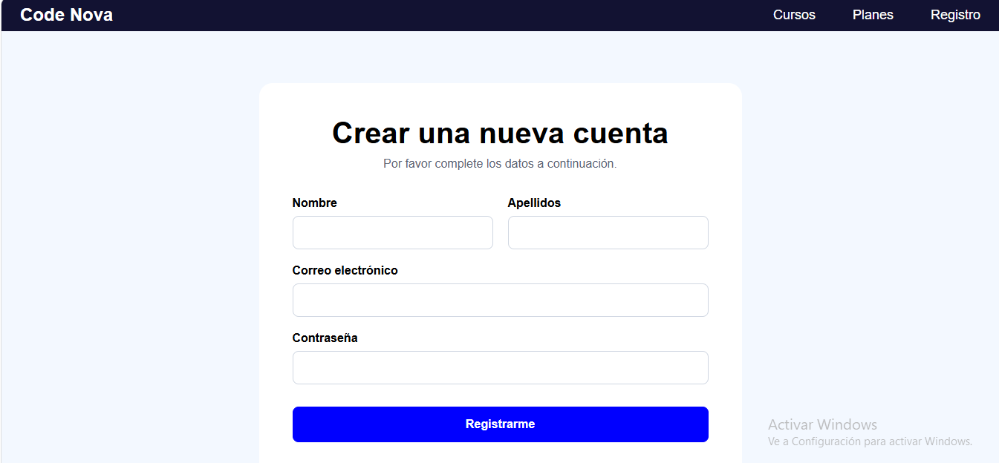
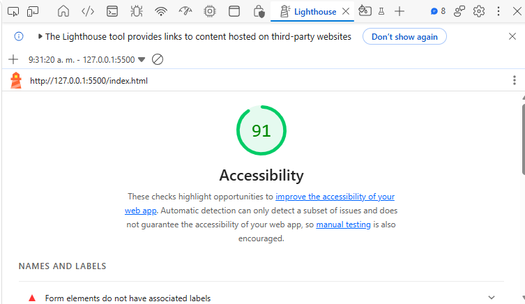
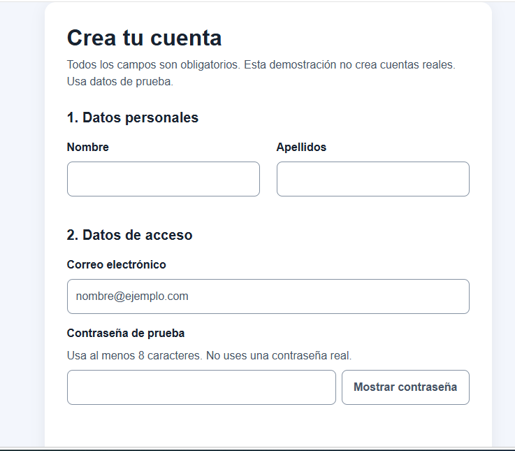
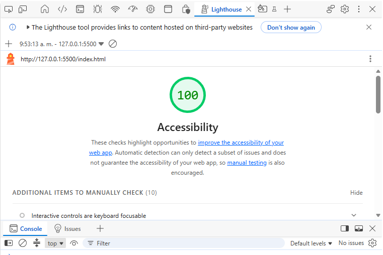

# Auditoría UX/UI — Code Nova

Se evaluó el formulario de registro del primer ciclo, reconstruido
a partir de las capturas del examen. El logo se sustituyó por texto.

## Heurísticas de Nielsen

| Heurística                     | Problema original                                            | Solución aplicada                                                          |
| ------------------------------ | ------------------------------------------------------------ | -------------------------------------------------------------------------- |
| Visibilidad del estado         | No confirmaba el registro.                                   | Se muestran mensajes de error, procesamiento y éxito.                      |
| Coincidencia con el mundo real | No indicaba campos obligatorios ni requisitos de contraseña. | Se añadieron instrucciones claras y requisitos visibles.                   |
| Control y libertad             | No permitía limpiar los datos de forma controlada.           | Se agregó limpieza con confirmación y opción de cancelar.                  |
| Prevención de errores          | Permitía enviar campos vacíos.                               | Se validan campos obligatorios, nombres con espacios, correo y contraseña. |
| Reconocer, no recordar         | No permitía revisar la contraseña escrita.                   | Se añadió un botón para mostrarla u ocultarla.                             |

## Leyes de usabilidad

| Ley    | Mejora aplicada y justificación                                                                                |
| ------ | -------------------------------------------------------------------------------------------------------------- |
| Fitts  | Botones de al menos 48 px de alto y separación de 24 px entre registro y limpieza para facilitar su selección. |
| Hick   | Se retiraron enlaces sin destino funcional para reducir decisiones innecesarias.                               |
| Miller | Se agruparon los campos en Datos personales y Datos de acceso para facilitar su comprensión.                   |

## Diseño y accesibilidad

Se asociaron etiquetas y campos mediante for e id y se corrigió
el idioma a español. Se aplicaron variables CSS, un solo h1,
espaciado consistente, foco visible, colores de texto con contraste
mínimo de 4.5:1 y distribución adaptable a pantallas pequeñas.

La pantalla no contiene imágenes. Las capturas de esta auditoría
incluyen texto alternativo.

Se adaptó el requisito de impedir notas vacías a impedir registros
con campos vacíos o nombres compuestos únicamente por espacios.
El registro es una simulación que no almacena datos ni contraseñas.

## Antes del rediseño

El puntaje corresponde a la reconstrucción del formulario.
Lighthouse detectó campos sin etiquetas asociadas.

## Después del rediseño

La accesibilidad aumentó de 91 a 100 puntos.

Se probaron campos vacíos, nombres con espacios, correo incorrecto,
contraseña corta, mostrar y ocultar contraseña, registro simulado
y confirmación o cancelación de limpieza. Funcionaron correctamente.

El puntaje automático se complementa con la revisión manual
de navegación por teclado y foco visible.
